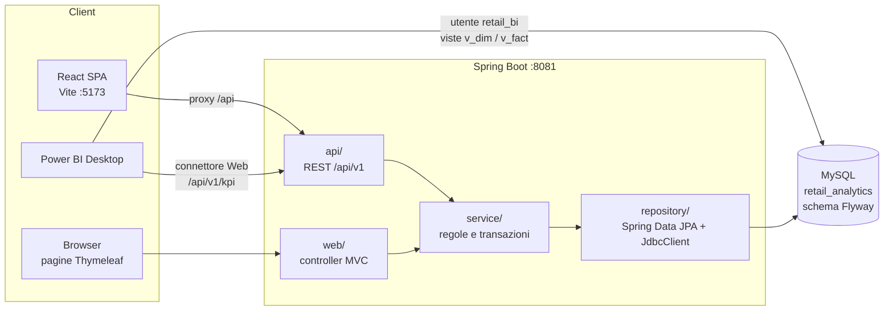

# Retail Analytics


**[Demo online del front-end](https://Auticad.github.io/retail-analytics/)**: dashboard e negozi con dati
di esempio, in sola lettura.

Applicazione full-stack per l'analisi delle vendite di una rete di negozi: backend Spring Boot con API REST,
due front-end (Thymeleaf lato server e React lato client) e un modello a stella pronto per Power BI.
Le tre interfacce leggono gli stessi calcoli, quindi i numeri coincidono per costruzione.

> **Abstract (EN).** Full-stack retail sales analytics application. A Spring Boot 4 / Java 21 backend exposes
> a documented REST API (OpenAPI) over a MySQL database whose schema and sample data (about 35,000 sales rows)
> are managed by Flyway. The same services feed a server-side Thymeleaf UI, a React + Vite single-page app
> with store management and a KPI dashboard, and Power BI through read-only star-schema views or the KPI
> endpoints. Errors follow RFC 9457 (ProblemDetail); tests cover unit, web-slice and Testcontainers
> integration levels. A read-only demo of the React app, built from a static snapshot of the API data, is
> published on GitHub Pages. Documentation below is in Italian.

---

## Indice

1. [Funzionalità](#funzionalità)
2. [Architettura](#architettura)
3. [Stack tecnologico](#stack-tecnologico)
4. [Modello dati](#modello-dati)
5. [Prerequisiti](#prerequisiti)
6. [Installazione](#installazione)
7. [Avvio](#avvio)
8. [Indirizzi dell'applicazione](#indirizzi-dellapplicazione)
9. [API REST](#api-rest)
10. [Front-end](#front-end)
11. [Demo su GitHub Pages](#demo-su-github-pages)
12. [Power BI](#power-bi)
13. [Configurazione](#configurazione)
14. [Test](#test)
15. [Struttura del repository](#struttura-del-repository)
16. [Scelte progettuali](#scelte-progettuali)
17. [Limiti noti e sviluppi futuri](#limiti-noti-e-sviluppi-futuri)
18. [Licenza](#licenza)
19. [Autore e contatti](#autore-e-contatti)

---

## Funzionalità

| Area      | Cosa fa                                                                                                                                                            |
| --------- | ------------------------------------------------------------------------------------------------------------------------------------------------------------------ |
| Negozi    | Elenco filtrabile per distretto, creazione, modifica, eliminazione. Codice univoco; un negozio con vendite non si elimina, si disattiva                            |
| Vendite   | Elenco paginato per periodo e negozio; registrazione con prezzo di listino o scontato. Rifiutate le vendite future, precedenti all'apertura o su negozi non attivi |
| KPI       | Fatturato, margine e margine %, pezzi, valore medio riga; andamento mensile con obiettivo; classifiche per negozio, distretto, categoria e prodotto                |
| Dashboard | Thymeleaf su `/`, React su `http://localhost:5173`, entrambe con filtro per periodo                                                                                |
| Power BI  | Viste `v_dim_*` e `v_fact_*` per un modello a stella, utente MySQL di sola lettura, query M e misure DAX pronte                                                    |
| Qualità   | Validazione dichiarativa, errori in formato ProblemDetail, documentazione OpenAPI, test su tre livelli                                                             |

Senza un periodo esplicito, i KPI usano gli ultimi 12 mesi che terminano con l'ultima vendita registrata,
così le dashboard non restano vuote quando i dati non arrivano fino a oggi.

---

## Architettura



| Strato             | Pacchetto     | Responsabilità                                                                                         |
| ------------------ | ------------- | ------------------------------------------------------------------------------------------------------ |
| Presentazione REST | `api/`        | Controller `@RestController`, DTO in ingresso e in uscita, traduzione delle eccezioni in ProblemDetail |
| Presentazione HTML | `web/`        | Controller MVC e form per le pagine Thymeleaf                                                          |
| Servizi            | `service/`    | Regole di business, transazioni, eccezioni applicative (`NotFoundException`, `ConflictException`)      |
| Accesso ai dati    | `repository/` | Spring Data JPA per il CRUD, SQL esplicito con `JdbcClient` per le query di reporting                  |
| Dominio            | `domain/`     | Entità JPA                                                                                             |
| Contratti          | `dto/`        | Record Java con le regole di validazione                                                               |

---

## Stack tecnologico

| Ambito                | Tecnologia                                                                      |
| --------------------- | ------------------------------------------------------------------------------- |
| Linguaggio e build    | Java 21, Maven 3.9 (wrapper `mvnw` incluso)                                     |
| Framework             | Spring Boot 4.1.2: Web MVC, Data JPA, Validation, Thymeleaf, Actuator, DevTools |
| Database              | MySQL 9 in sviluppo e nei test; lo stack Docker Compose usa `mysql:8.4`         |
| Migrazioni            | Flyway (`spring-boot-starter-flyway`, `flyway-mysql`)                           |
| Documentazione API    | springdoc-openapi 3.2.0 (Swagger UI)                                            |
| Front-end server-side | Thymeleaf                                                                       |
| Front-end client-side | React 19, Vite 8, Recharts 3, Oxlint                                            |
| Test                  | JUnit 5, Mockito, MockMvc, Testcontainers (`mysql:9`)                           |
| Container             | Dockerfile multi-stage (build Maven, esecuzione su JRE 21), Docker Compose      |
| Analisi               | Power BI Desktop: query M e misure DAX nella cartella `powerbi/`                |

---

## Modello dati

### Tabelle operative

| Tabella          | Contenuto                                                                        |
| ---------------- | -------------------------------------------------------------------------------- |
| `district`       | Distretti commerciali con responsabile                                           |
| `store`          | Negozi: codice, città, provincia, distretto, superficie, data di apertura, stato |
| `category`       | Categorie merceologiche                                                          |
| `product`        | Prodotti con SKU, categoria, prezzo di listino e costo unitario                  |
| `sale`           | Righe di vendita: data, negozio, prodotto, quantità, prezzo, importo, costo      |
| `monthly_target` | Obiettivo di fatturato per negozio e mese                                        |
| `dim_date`       | Calendario 2025–2026 con anno, trimestre, mese, giorno della settimana, weekend  |

### Viste per l'analisi (schema a stella)

```
                    v_dim_date
                        │ date_key
v_dim_store ────── v_fact_sales ────── v_dim_product
   store_key                              product_key
        └───────── v_fact_target ───── v_dim_date
```

Le dimensioni appiattiscono le tabelle normalizzate (ad esempio `v_dim_store` include nome e responsabile del
distretto); `v_fact_sales` espone anche `margin_amount`.

### Dati di esempio

Al primo avvio Flyway esegue le migrazioni `V1`–`V4` e carica dati di esempio: 3 distretti, 12 negozi,
6 categorie, 24 prodotti, obiettivi mensili e circa 35.000 righe di vendita dal 2025-01-01 al 2026-10-31.
Le vendite sono generate in modo deterministico (CRC32 come generatore pseudo-casuale), quindi ogni
installazione e ogni test ottengono esattamente le stesse righe.

---

## Prerequisiti

| Strumento        | Versione                             | Serve per                                                        |
| ---------------- | ------------------------------------ | ---------------------------------------------------------------- |
| JDK              | 21                                   | backend (variabile `JAVA_HOME` impostata)                        |
| Docker Desktop   | recente                              | MySQL in container e test di integrazione                        |
| Node.js          | 20.19+ oppure 22.12+                 | front-end React                                                  |
| Git              | recente                              | clonare il repository                                            |
| IDE              | VS Code (consigliato) oppure Eclipse | sviluppo                                                         |
| Power BI Desktop | facoltativo                          | report; per il connettore MySQL serve Oracle MySQL Connector/NET |

Maven non va installato: il wrapper `mvnw` / `mvnw.cmd` scarica la versione corretta.

---

## Installazione

### 1. Clonare il repository

```powershell
git clone https://github.com/Auticad/retail-analytics.git
cd retail-analytics
```

### 2. Preparare il database

L'applicazione ha bisogno di un server MySQL. Le due strade seguenti usano **due server diversi**, ognuno con
i propri dati: non è lo stesso database esposto su due porte.

|                               | A. Container MySQL già esistente             | B. MySQL dedicato di Docker Compose                     |
| ----------------------------- | -------------------------------------------- | ------------------------------------------------------- |
| Chi lo crea                   | Tu, una volta, con `docker run`              | `docker compose up -d db`, dal file `compose.yaml`      |
| Nome del container            | `<NOME_CONTAINER_MYSQL>`                     | `retail-analytics-db`                                   |
| Immagine                      | quella scelta da te (in sviluppo `mysql:9`)  | `mysql:8.4`                                             |
| Porta sul PC                  | `3310`                                       | `3311`                                                  |
| Porta usata dall'applicazione | `3310`, valore predefinito: nessuna modifica | `3311`: va indicata con `DB_PORT`                       |
| Database e utenti             | Da creare con lo script `db/init`            | Creati dal container al primo avvio, tranne `retail_bi` |

Le porte sono diverse perché i due server possano convivere sullo stesso PC: due container non possono
pubblicare la stessa porta. All'interno di ogni container MySQL ascolta sempre sulla 3306; il numero
3310 o 3311 è solo la porta del PC che inoltra verso quella 3306. L'applicazione si collega al server
indicato da `DB_PORT`, quindi con la strada B, senza `DB_PORT=3311`, si collegherebbe al server sbagliato
o a nessun server.

**A. Un container MySQL che hai già.** Esegui una volta lo script che crea il database, l'utente
applicativo e l'utente di sola lettura per Power BI:

```powershell
Get-Content db\init\01-create-database.sql | docker exec -i <NOME_CONTAINER_MYSQL> mysql -uroot -p<PASSWORD_ROOT_MYSQL>
```

**B. Il MySQL dedicato di Docker Compose**, utile se non hai già un container MySQL. Il container crea da
solo database e utente applicativo:

```powershell
$env:MYSQL_ROOT_PASSWORD = "<PASSWORD_ROOT_MYSQL>"
docker compose up -d db
$env:DB_PORT = "3311"          # nel terminale da cui avvii il backend
```

L'avvio unico da VS Code descritto più avanti presuppone la strada A; con la strada B imposta `DB_PORT=3311`
nelle variabili d'ambiente di Windows oppure avvia il backend a mano.

Con la strada B l'utente `retail_bi` per Power BI non esiste: se ti serve, esegui anche lo script del punto A
sul container `retail-analytics-db`.

Le tabelle non vanno create a mano: le crea Flyway al primo avvio dell'applicazione.

### 3. Installare le dipendenze del front-end

```powershell
cd frontend
npm install
cd ..
```

---

## Avvio

### A. Avvio unico da VS Code

Con un solo task VS Code avvia Docker Desktop se non è attivo, avvia il container MySQL, attende che il
database risponda e poi lancia in parallelo backend e front-end, ciascuno nel proprio terminale.

La cartella `.vscode/` è esclusa da Git (`.gitignore`), perché contiene impostazioni della singola macchina.
I due file vanno quindi creati nel proprio clone.

1. Apri in VS Code la cartella del repository (quella che contiene `pom.xml`) e installa l'estensione
   **Extension Pack for Java**.
2. Crea `.vscode/avvia-docker-mysql.ps1` e sostituisci `<NOME_CONTAINER_MYSQL>` con il nome del tuo container
   (`docker ps -a` per vederlo).

<details>
<summary><code>.vscode/avvia-docker-mysql.ps1</code></summary>

```powershell
# Avvia Docker Desktop (se non e' gia' attivo) e il container MySQL del progetto.
# Usato dal task "MySQL" di .vscode/tasks.json.

$container     = '<NOME_CONTAINER_MYSQL>'
$dockerDesktop = Join-Path $env:ProgramFiles 'Docker\Docker\Docker Desktop.exe'

# 1. Docker Engine raggiungibile?
docker info *> $null
if ($LASTEXITCODE -ne 0) {
    if (-not (Test-Path $dockerDesktop)) {
        Write-Error "Docker Desktop non trovato in: $dockerDesktop"
        exit 1
    }
    Write-Host 'Docker non attivo: avvio Docker Desktop...'
    Start-Process $dockerDesktop
    $limite = (Get-Date).AddMinutes(3)
    do {
        Start-Sleep -Seconds 3
        docker info *> $null
    } while ($LASTEXITCODE -ne 0 -and (Get-Date) -lt $limite)
    if ($LASTEXITCODE -ne 0) {
        Write-Error 'Docker non risulta pronto dopo 3 minuti.'
        exit 1
    }
}
Write-Host 'Docker pronto.'

# 2. Container MySQL (docker start non fa nulla se e' gia' in esecuzione)
docker start $container | Out-Null
if ($LASTEXITCODE -ne 0) {
    Write-Error "Impossibile avviare il container $container (esiste? docker ps -a)"
    exit 1
}

# 3. Attesa che MySQL accetti connessioni (ping restituisce 0 se il server e' attivo)
$limite = (Get-Date).AddMinutes(1)
do {
    Start-Sleep -Seconds 2
    docker exec $container mysqladmin ping --silent *> $null
} while ($LASTEXITCODE -ne 0 -and (Get-Date) -lt $limite)

if ($LASTEXITCODE -eq 0) {
    Write-Host "MySQL pronto nel container $container."
} else {
    Write-Warning 'MySQL non risponde ancora: il backend potrebbe fallire al primo avvio.'
}
```

</details>

3. Crea `.vscode/tasks.json`:

<details>
<summary><code>.vscode/tasks.json</code></summary>

```jsonc
{
  // Terminal > Run Task > "Avvia retail-analytics"
  // Ordine: Docker + MySQL, poi backend (8081) e front-end (5173) in parallelo.
  "version": "2.0.0",
  "tasks": [
    {
      "label": "MySQL",
      "type": "process",
      "command": "powershell.exe",
      "args": [
        "-NoProfile",
        "-ExecutionPolicy",
        "Bypass",
        "-File",
        "${workspaceFolder}\\.vscode\\avvia-docker-mysql.ps1",
      ],
      "problemMatcher": [],
    },
    {
      "label": "Backend",
      "type": "shell",
      "command": ".\\mvnw.cmd spring-boot:run",
      "isBackground": true,
      "presentation": { "panel": "dedicated" },
      "problemMatcher": [],
    },
    {
      "label": "Frontend",
      "type": "shell",
      "command": "if (-not (Test-Path node_modules)) { npm install }; npm run dev",
      "options": { "cwd": "${workspaceFolder}\\frontend" },
      "isBackground": true,
      "presentation": { "panel": "dedicated" },
      "problemMatcher": [],
    },
    {
      "label": "Backend e Frontend",
      "dependsOrder": "parallel",
      "dependsOn": ["Backend", "Frontend"],
      "problemMatcher": [],
    },
    {
      "label": "Avvia retail-analytics",
      "dependsOrder": "sequence",
      "dependsOn": ["MySQL", "Backend e Frontend"],
      "problemMatcher": [],
    },
  ],
}
```

</details>

4. Avvia con _Terminal → Run Task → Avvia retail-analytics_. Il backend è pronto quando nel suo terminale
   compare `Started RetailAnalyticsApplication` (10–20 secondi); il front-end in pochi secondi.
5. Per fermare tutto: <kbd>Ctrl</kbd>+<kbd>C</kbd> in ciascun terminale. Il container MySQL resta attivo;
   si ferma con `docker stop <NOME_CONTAINER_MYSQL>`.

> Lo script cerca Docker Desktop nel percorso di installazione predefinito. In alternativa si può impostare
> Docker Desktop perché parta all'accesso a Windows (_Settings → General → Start Docker Desktop when you sign in_).

### B. Avvio manuale

Con il container MySQL attivo, in due terminali separati:

```powershell
# terminale 1: backend
.\mvnw.cmd spring-boot:run

# terminale 2: front-end React
cd frontend
npm run dev
```

In Eclipse: _File → Import → Existing Maven Projects_, poi _Run As → Spring Boot App_ (o _Java Application_)
sulla classe `RetailAnalyticsApplication`. Non avviare l'applicazione da due IDE insieme: la seconda istanza
si ferma con `Port 8081 was already in use`.

### C. Tutto in container

Database e applicazione containerizzata, senza JDK sulla macchina:

```powershell
$env:MYSQL_ROOT_PASSWORD = "<PASSWORD_ROOT_MYSQL>"
docker compose --profile app up -d --build
```

L'applicazione risponde su `http://localhost:8081`. Il front-end React in questo scenario si avvia a parte
con `npm run dev`.

---

## Indirizzi dell'applicazione

| Indirizzo                             | Contenuto                                  |
| ------------------------------------- | ------------------------------------------ |
| http://localhost:8081/                | Dashboard Thymeleaf                        |
| http://localhost:8081/stores          | Gestione negozi (Thymeleaf)                |
| http://localhost:8081/sales           | Elenco e registrazione vendite (Thymeleaf) |
| http://localhost:8081/swagger-ui.html | Documentazione interattiva delle API       |
| http://localhost:8081/v3/api-docs     | Specifica OpenAPI in JSON                  |
| http://localhost:8081/actuator/health | Stato dell'applicazione                    |
| http://localhost:5173/                | Front-end React (dashboard e negozi)       |

---

## API REST

Tutti gli endpoint sono sotto `/api/v1`. I parametri `from` e `to` usano il formato `yyyy-MM-dd` e sono
facoltativi.

| Metodo | Endpoint                                | Descrizione                                                    | Esiti principali           |
| ------ | --------------------------------------- | -------------------------------------------------------------- | -------------------------- |
| GET    | `/districts`                            | Distretti                                                      | 200                        |
| GET    | `/products`                             | Prodotti con categoria, listino e costo                        | 200                        |
| GET    | `/stores?districtId=`                   | Negozi, filtrabili per distretto                               | 200                        |
| GET    | `/stores/{id}`                          | Dettaglio negozio                                              | 200, 404                   |
| POST   | `/stores`                               | Crea un negozio                                                | 201 + `Location`, 400, 409 |
| PUT    | `/stores/{id}`                          | Modifica un negozio                                            | 200, 400, 404, 409         |
| DELETE | `/stores/{id}`                          | Elimina un negozio senza vendite                               | 204, 404, 409              |
| GET    | `/sales?from=&to=&storeId=&page=&size=` | Vendite paginate, dalla più recente                            | 200                        |
| POST   | `/sales`                                | Registra una vendita (`unitPrice` facoltativo: listino)        | 201, 400, 404, 409         |
| GET    | `/kpi/summary`                          | Fatturato, margine, margine %, pezzi, valore medio riga        | 200                        |
| GET    | `/kpi/monthly`                          | Andamento mensile con obiettivo                                | 200                        |
| GET    | `/kpi/stores`                           | Classifica negozi: fatturato, margine, obiettivo %, resa al m² | 200                        |
| GET    | `/kpi/districts`                        | Vendite per distretto                                          | 200                        |
| GET    | `/kpi/categories`                       | Vendite per categoria                                          | 200                        |
| GET    | `/kpi/top-products?limit=`              | Prodotti per fatturato (`limit` da 1 a 50, predefinito 10)     | 200                        |

### Formato degli errori

Gli errori seguono la RFC 9457 (`application/problem+json`). Gli errori di validazione includono la mappa
`errors` campo → messaggio; le violazioni di regole riferite a un campo includono `field`.

```json
{
  "type": "about:blank",
  "title": "Dati non validi",
  "status": 400,
  "detail": "Uno o più campi non superano la validazione",
  "instance": "/api/v1/stores",
  "errors": {
    "code": "Il codice è obbligatorio",
    "province": "La provincia è una sigla di 2 lettere"
  }
}
```

---

## Front-end

### Thymeleaf (lato server)

Pagine generate dal backend sulla porta 8081: dashboard con KPI, grafico mensile e classifiche; gestione
negozi; elenco e registrazione delle vendite. Usano i controller di `web/` e gli stessi service delle API.

### React (lato client)

Applicazione Vite + React nella cartella `frontend/`, con due pagine:

- **Dashboard**: quattro KPI, fatturato mensile contro obiettivo (Recharts), classifica dei negozi, filtro per periodo;
- **Negozi**: CRUD con filtro per distretto. Gli errori 400 e 409 restituiti dal server sono mostrati sotto il campo corrispondente.

In sviluppo il proxy di Vite (`frontend/vite.config.js`) inoltra le chiamate `/api` a `http://localhost:8081`,
quindi il backend non richiede configurazione CORS.

```powershell
cd frontend
npm run dev        # sviluppo, http://localhost:5173
npm run lint       # analisi statica (Oxlint)
npm run build      # build ottimizzata in frontend/dist
```

---

## Demo su GitHub Pages

GitHub Pages pubblica solo file statici e non può eseguire Spring Boot né MySQL. La demo è quindi una build
del front-end React in **modalità demo**: invece di chiamare le API legge un'istantanea delle loro risposte,
salvata in file JSON.

|                         | Applicazione completa           | Demo su Pages                                                      |
| ----------------------- | ------------------------------- | ------------------------------------------------------------------ |
| Dati                    | Letti da MySQL a ogni richiesta | Istantanea in `frontend/public/demo/*.json`                        |
| Periodo della dashboard | Date libere                     | Tre periodi predefiniti: ultimi 12 mesi, anno 2025, 2026 (gen–ott) |
| Negozi                  | CRUD completo                   | Elenco e filtro per distretto; le modifiche mostrano un avviso     |
| Indirizzo               | `http://localhost:5173`         | `https://Auticad.github.io/retail-analytics/`                      |

### Come funziona

- `vite build --mode demo` attiva la modalità demo (`import.meta.env.MODE === 'demo'`) e imposta il percorso
  base `/retail-analytics/`, perché su Pages l'app sta in una sottocartella;
- in modalità demo `frontend/src/api/client.js` legge `demo/<chiamata>.json` invece di chiamare `/api/v1`,
  e rifiuta le operazioni di scrittura con un messaggio;
- il workflow `.github/workflows/demo-pages.yml` crea la build e la pubblica a ogni push su `main` che modifica
  `frontend/`. Si può avviare anche a mano dalla scheda _Actions_.

### Prima pubblicazione

1. Su GitHub: _Settings → Pages → Build and deployment → Source: GitHub Actions_.
2. Con il backend avviato, genera l'istantanea dei dati:

   ```powershell
   cd frontend
   npm run demo:snapshot
   ```

   Lo script interroga `http://localhost:8081/api/v1` e scrive i file in `frontend/public/demo/`
   (indirizzo diverso: variabile `API_URL`).

3. Prova la demo in locale, a backend spento:

   ```powershell
   npm run build:demo
   npm run preview:demo      # http://localhost:4173/retail-analytics/
   ```

4. Salva l'istantanea su Git ed esegui il push: il workflow pubblica la demo in un paio di minuti.

```powershell
git add frontend/public/demo
git commit -m "Demo: istantanea dei dati"
git push
```

L'istantanea va rigenerata solo se cambiano i dati di esempio o la forma delle API. Se la cartella
`frontend/public/demo` manca, il workflow si ferma con un messaggio che indica il comando da eseguire.

---

## Power BI

Il progetto offre due canali verso Power BI.

|            | Viste sul database                                                            | API REST                                     |
| ---------- | ----------------------------------------------------------------------------- | -------------------------------------------- |
| Sorgente   | `v_dim_date`, `v_dim_store`, `v_dim_product`, `v_fact_sales`, `v_fact_target` | `/api/v1/kpi/*`                              |
| Connettore | MySQL database (utente di sola lettura `retail_bi`)                           | Web, risposta JSON                           |
| Calcoli    | Misure DAX nel modello                                                        | Già eseguiti dall'applicazione               |
| Uso tipico | Analisi libera per data, negozio, prodotto                                    | Numeri ufficiali, database non raggiungibile |

Nella cartella `powerbi/`:

- `sorgenti.pq`: query Power Query (M) per entrambi i canali;
- `misure.dax`: misure del modello (Fatturato, Margine, Margine %, Pezzi, Valore medio riga, Obiettivo,
  Raggiungimento %, Fatturato YTD, Fatturato al m², e altre).

Prerequisito: `v_dim_date` contrassegnata come tabella data sulla colonna `date_value`.

---

## Configurazione

I parametri di connessione hanno un valore predefinito per lo sviluppo locale e si sovrascrivono con
variabili d'ambiente.

| Variabile             | Predefinito                                    | Significato                                                |
| --------------------- | ---------------------------------------------- | ---------------------------------------------------------- |
| `DB_HOST`             | `localhost`                                    | Host di MySQL                                              |
| `DB_PORT`             | `3310`                                         | Porta pubblicata dal container (`3311` con Docker Compose) |
| `DB_NAME`             | `retail_analytics`                             | Database                                                   |
| `DB_USER`             | `retail`                                       | Utente applicativo                                         |
| `DB_PASSWORD`         | valore di sviluppo in `application.properties` | Password dell'utente applicativo                           |
| `MYSQL_ROOT_PASSWORD` | valore di sviluppo in `compose.yaml`           | Password di root, solo per lo stack Docker Compose         |

Esempio in PowerShell, valido per la sessione corrente del terminale:

```powershell
$env:DB_PASSWORD = "<PASSWORD_APP>"
.\mvnw.cmd spring-boot:run
```

Altre impostazioni in `src/main/resources/application.properties`: porta `8081`, `ddl-auto=validate`
(lo schema lo governa Flyway), `open-in-view=false`, Actuator limitato a `health` e `info`, OpenAPI limitato
a `/api/**`.

> **Sicurezza.** I valori predefiniti presenti nel repository sono credenziali di sviluppo, valide solo per un
> database locale con dati di esempio. In qualsiasi altro ambiente le password si passano con variabili
> d'ambiente e non si salvano nei file. Il file `.env` è escluso da Git.

---

## Test

| Livello      | Classe                         | Cosa verifica                                                                                                                        | Requisiti      |
| ------------ | ------------------------------ | ------------------------------------------------------------------------------------------------------------------------------------ | -------------- |
| Unitario     | `SaleServiceTest`              | Regole di registrazione vendita: prezzo di listino o scontato, data precedente all'apertura, negozio non attivo, negozio inesistente | Nessuno        |
| Strato web   | `StoreApiControllerTest`       | Controller, validazione, JSON e ProblemDetail con il service simulato (`@WebMvcTest`)                                                | Nessuno        |
| Integrazione | `RetailAnalyticsApplicationIT` | Applicazione completa su MySQL reale: migrazioni, KPI, CRUD negozi, vendite, dashboard, OpenAPI                                      | Docker avviato |

```powershell
.\mvnw.cmd test      # test unitari e di strato web
.\mvnw.cmd verify    # aggiunge i test di integrazione (Testcontainers, immagine mysql:9)
```

`verifica.bat` esegue `verify` e scrive l'esito in `verifica-log.txt` (escluso da Git).

---

## Struttura del repository

```
retail-analytics/
├── src/main/java/io/github/auticad/retail/
│   ├── api/            controller REST e gestione errori (ProblemDetail)
│   ├── web/            controller MVC e form Thymeleaf
│   ├── service/        regole di business e transazioni
│   ├── repository/     Spring Data JPA + query KPI con JdbcClient
│   ├── domain/         entità JPA
│   ├── dto/            record di ingresso e uscita con validazione
│   └── config/         configurazione OpenAPI
├── src/main/resources/
│   ├── db/migration/   migrazioni Flyway V1–V4 (schema, anagrafiche, vendite, viste)
│   ├── templates/      pagine Thymeleaf
│   ├── static/css/     foglio di stile
│   └── application.properties
├── src/test/java/      test unitari, di strato web e di integrazione
├── frontend/           front-end React (Vite)
│   ├── public/demo/    istantanea dei dati per la demo su GitHub Pages
│   └── scripts/        script che genera l'istantanea
├── .github/workflows/  pubblicazione della demo su GitHub Pages
├── powerbi/            query M e misure DAX
├── db/init/            script di creazione database e utenti
├── Dockerfile          immagine multi-stage dell'applicazione
├── compose.yaml        MySQL dedicato e applicazione containerizzata
├── verifica.bat        build e test completi con log
├── LICENSE             licenza MIT
└── mvnw, mvnw.cmd      Maven wrapper
```

Non versionati: `target/`, `frontend/node_modules/`, `frontend/dist/`, `.vscode/`, impostazioni di Eclipse,
`.env`.

---

## Scelte progettuali

- **DTO come record separati dalle entità.** Il contratto delle API non cambia se cambia il modello JPA, e le
  regole di validazione stanno nei record (`StoreRequest`, `SaleRequest`).
- **Schema governato da Flyway.** Hibernate si limita a verificare la corrispondenza (`ddl-auto=validate`);
  ogni modifica allo schema è una migrazione versionata.
- **JPA per il CRUD, SQL esplicito per i KPI.** Le aggregazioni di reporting sono scritte con `JdbcClient`:
  più leggibili e controllabili di query JPQL equivalenti.
- **Errori in ProblemDetail.** Un unico formato per validazione, risorse assenti e regole di business, che i
  client REST (front-end React, Power BI, Swagger UI) interpretano allo stesso modo.
- **Un'unica fonte per i calcoli.** Dashboard Thymeleaf, front-end React e canale REST di Power BI usano le
  stesse query di `KpiRepository`.
- **Dati di esempio deterministici.** Generati in SQL con una funzione hash, rendono riproducibili sia le demo
  sia i test di integrazione.

---

## Limiti noti e sviluppi futuri

| Limite                                                            | Sviluppo previsto                                                       |
| ----------------------------------------------------------------- | ----------------------------------------------------------------------- |
| Nessuna autenticazione: l'applicazione è pensata per l'uso locale | Spring Security con ruoli separati per consultazione e gestione         |
| Front-end React senza test né routing                             | Vitest + Testing Library; React Router                                  |
| Demo con periodi predefiniti                                      | Più periodi nell'istantanea, o un backend ospitato per la demo completa |
| Front-end e backend si avviano separatamente                      | `frontend-maven-plugin` per includere la build React nel JAR            |
| Tipi del front-end scritti a mano                                 | Generazione da `/v3/api-docs` con TypeScript e `openapi-typescript`     |
| Pagina vendite solo in Thymeleaf                                  | Pagina vendite paginata anche in React                                  |

---

## Licenza

Distribuito con licenza MIT: il codice si può usare, modificare e ridistribuire, anche a fini commerciali,
mantenendo l'avviso di copyright. Il testo completo è nel file [`LICENSE`](LICENSE).

---

## Autore e contatti

**Pietro Cammise**

- GitHub: [github.com/Auticad](https://github.com/Auticad)
- LinkedIn: [linkedin.com/in/pietrocammise](https://www.linkedin.com/in/pietrocammise)
- Portfolio: [https://auticad.github.io/portfolio-cammise/](https://auticad.github.io/portfolio-cammise/)
- Email: pietro_cam@hotmail.com

Progetto realizzato a scopo formativo e di portfolio. I dati sono interamente sintetici.
